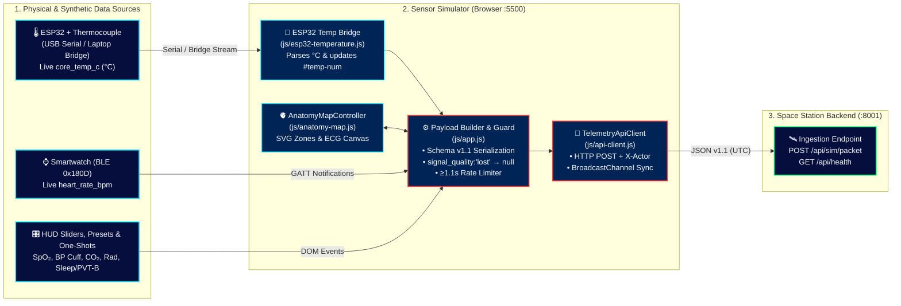
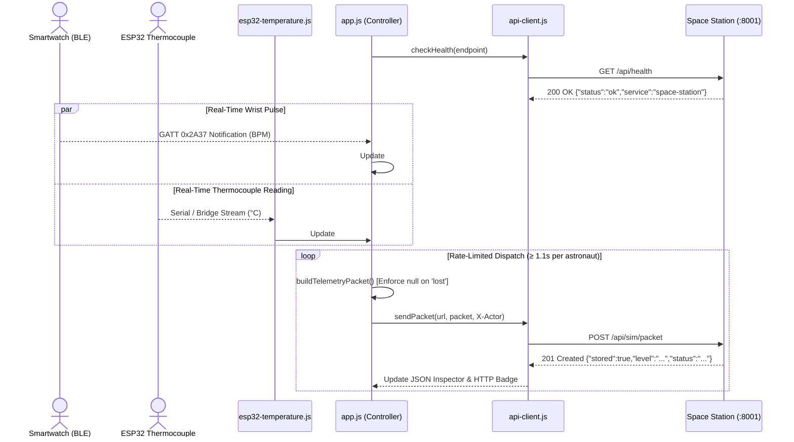

# Astro Health Monitor — Biomedical Sensor Telemetry Simulator (App 3)

**NASA Space Apps Challenge 2026 • Hybrid Hardware-in-the-Loop & Telemetry Deck**

The **Sensor Telemetry Simulator** is a zero-build, browser-based aerospace HUD application that combines **real physical biometric sensors** (a BLE smartwatch and an ESP32-bridged thermocouple) with **synthetic aerospace telemetry controls** for deep-space crews. It serializes strictly validated **`telemetry-v1.1.json`** packets and streams them in real time to the **Space Station Edge Backend (`:8001`)**.

> **Architectural Boundary:** The simulator acts purely as a hardware-acquisition and telemetry-emulation layer. It **does not** compute clinical severity colors (Green, Yellow, Orange, Red)—those thresholds are evaluated server-side by the Space Station clinical engine based on crew baselines, `activity_state`, and cumulative exposure.

---

## Key Features

* **Hybrid Hardware-in-the-Loop (HIL) Telemetry:**
  * **Live Wrist Heart Rate (`Web Bluetooth / GATT 0x180D`):** Connects directly to a **Samsung Galaxy Watch 8 Classic** or **Huawei Watch GT Cyber** to inject real-time `heart_rate_bpm` readings into the cardiovascular channel.
  * **Live Core/Skin Temperature (`ESP32 + Thermocouple`):** Powered by `js/esp32-temperature.js`, reads real-time temperature telemetry from a thermocouple wired to an **ESP32 microcontroller** connected to the host laptop, dynamically updating `biometrics.thermoregulation.core_temp_c`.
  * **Synthetic Multi-System Controls:** Completes the remaining physiological and environmental channels (`SpO₂`, respiratory rate, periodic cuff blood pressure, cabin `CO₂`, radiation dosimetry, Solar Particle Events, and daily sleep/PVT-B assessments).
* **Interactive Anatomical HUD:** Clickable SVG human silhouette with live signal-quality styling (`good`, `degraded`, `lost`) across five physiological and dosimetry zones.
* **Live ECG Lead II Oscilloscope:** Real-time HTML5 `<canvas>` waveform dynamically synchronized with incoming heart rate (BPM) and cardiovascular signal quality.
* **Strict `telemetry-v1.1.json` Enforcement:**
  * Automatically serializes sensor values as `null` when `signal_quality` is set to `"lost"`.
  * Keeps periodic cuff blood pressure and `daily_assessment` blocks `null` during continuous streaming unless explicitly attached or fired via **One-Shot** triggers (`source: "periodic_device_trigger"`).
  * Formats timestamps in clean UTC ISO-8601 (`YYYY-MM-DDTHH:MM:SSZ`) without milliseconds.
* **Built-in Throttling Guard:** Enforces a minimum interval of `1.1s` (`1100 ms`) between packets per astronaut to comply with the Space Station's 1-packet-per-second resolution limit.

---

## Simulator Architecture & Data Flow

### 1. Hybrid Hardware & Software Pipeline



### 2. Real-Time Acquisition & Throttling Sequence



---

## Directory Structure

```text
sensor-simulator/
├── index.html               # Aerospace HUD layout, SVG silhouette, ECG canvas & script loaders
├── README.md                # Simulator architecture, hardware bridges & contract documentation
└── js/
    ├── presets.js           # Pre-configured clinical & environmental mission scenarios
    ├── anatomy-map.js       # Interactive SVG organ selector and signal quality state styling
    ├── api-client.js        # Fetch wrapper for /api/sim/packet, /api/health, and BroadcastChannel
    ├── app.js               # Core state orchestrator, schema v1.1 serializer, BLE & stream loops
    └── esp32-temperature.js # Hardware bridge reading live thermocouple °C from laptop-connected ESP32
```

---

## Getting Started

### 1. Run the Simulator Locally

No build step or external bundler is required. Serve the `sensor-simulator/` directory using any static HTTP server:

```bash
cd sensor-simulator
python -m http.server 5500
```

Open **`http://localhost:5500`** in **Google Chrome** or **Microsoft Edge** (required for **Web Bluetooth** and **Web Serial** hardware APIs).

### 2. Connect to the Space Station Backend

1. Ensure your laptop is connected to the same local network/hotspot as the Space Station server.
2. In the top HUD bar, configure:
   * **CREW ID:** e.g., `AST-01`
   * **X-ACTOR:** Operator identifier logged in the station's audit trail (`/api/changes`)
   * **SPACE STATION ENDPOINT (:8001):** `http://<STATION_IP>:8001/api/sim/packet` (default `http://172.20.10.2:8001/api/sim/packet`)
3. Click **Ping Health** to verify connectivity (`ONLINE • space-station`).
4. Click **Push Once** to send a single manual packet, or **Start Stream** to transmit continuously.

---

## Hardware Integration Setup

### A. ESP32 + Thermocouple (`js/esp32-temperature.js`)

The thermoregulation channel (`biometrics.thermoregulation.core_temp_c`) can receive live temperature readings from a thermocouple (e.g., K-type with MAX6675/MAX31855 or digital probe) wired to an **ESP32** connected to your laptop via USB:

1. **ESP32 Firmware Output:** Flash the ESP32 to read the thermocouple and print clean Celsius values (or JSON lines such as `{"temp": 36.8}` / `36.8\n`) over USB Serial (typically `115200` baud).
2. **Laptop Connection:** Plug the ESP32 into an available USB port on your laptop (ensure no other Serial Monitor like Arduino IDE is holding the COM port open).
3. **Simulator Ingestion:** `js/esp32-temperature.js` captures incoming readings from the ESP32 bridge, clamps/validates them within the physiological range (`30.0 °C – 44.0 °C`), updates `#temp-num` and `#temp-slider`, sets `thermoregulation.signal_quality` to `"good"`, and refreshes the outbound JSON packet.

### B. Smartwatch Live Heart Rate (`Connect Watch (Live BLE)`)

To stream live wrist heart rate (`biometrics.cardiovascular.heart_rate_bpm`) into the simulator:

1. **Samsung Galaxy Watch 8 Classic (Wear OS):**
   * Install **Heart for Bluetooth** or **BLE Heart Rate** from Google Play Store on the watch.
   * Grant body-sensor permissions and tap **Start / Broadcast**.
2. **Huawei Watch GT Cyber (HarmonyOS):**
   * Complete initial pairing with *Huawei Health* on a smartphone, then disconnect the phone's Bluetooth.
   * On the watch, enable **Settings → Heart Rate Broadcast** (or start an indoor workout with HR broadcast enabled).
3. **Pair in Browser:**
   * Click **Connect Watch (Live BLE)** in the simulator header, select your watch from the browser's Bluetooth prompt, and pair.
   * Incoming BPM updates automatically drive the ECG waveform, anatomical heart animation, and throttled `POST` packets to `:8001`.

---

## Telemetry Contract (`telemetry-v1.1.json`)

### Outbound Payload Structure

```json
{
  "schema_version": "1.1",
  "header": {
    "packet_id": "TLM-20261114-0042",
    "astronaut_id": "AST-01",
    "measured_at": "2026-11-14T17:30:00Z",
    "source": "automated_sensor_stream"
  },
  "mission_context": {
    "activity_state": "resting",
    "comm_latency_sec": 2.6,
    "environment": {
      "cabin_co2_mmhg": 2.1
    }
  },
  "biometrics": {
    "cardiovascular": {
      "heart_rate_bpm": 68,
      "blood_pressure_systolic_mmhg": null,
      "blood_pressure_diastolic_mmhg": null,
      "sensor_hardware": "Bio-Monitor ECG",
      "signal_quality": "good"
    },
    "respiratory": {
      "spo2_percent": 98,
      "respiratory_rate_rpm": 14,
      "sensor_hardware": "Pulse Oximeter",
      "signal_quality": "good"
    },
    "thermoregulation": {
      "core_temp_c": 37.1,
      "sensor_hardware": "Double Sensor Forehead",
      "signal_quality": "good"
    }
  },
  "daily_assessment": null,
  "radiation_dosimetry": {
    "daily_rate_msv": 0.42,
    "solar_particle_event": {
      "active": false,
      "event_dose_msv": 0.0
    },
    "sensor_hardware": "RAD / Liulin Active Dosimeter",
    "signal_quality": "good"
  }
}
```

### Station Ingestion Rules

| Rule / Field | Behavior |
| :--- | :--- |
| **`signal_quality: "lost"`** | All numeric readings inside that sensor block are automatically serialized as `null` so the station marks the sensor offline. |
| **`signal_quality: "degraded"`** | Numeric values are preserved and flagged as low-confidence motion/fluid-shift readings. |
| **Timestamp Resolution** | Maximum **1 packet per second per astronaut**. Packets sharing the same second overwrite each other; `measured_at` must not be in the future. |
| **`daily_assessment`** | Sent as `null` by default. When attached or triggered via **Transmit Daily Report Once**, the station automatically tracks consecutive nights with `< 6.0h` of sleep. |

---

## Built-in Scenario Presets

| Preset | `activity_state` | Key Simulated Anomalies | Expected Station Response |
| :--- | :--- | :--- | :--- |
| **01. Nominal Orbit** | `resting` | HR `66 bpm`, SpO₂ `99%`, Temp `36.9 °C`, CO₂ `1.9 mmHg` | All systems nominal (Green) |
| **02. Attention (CO₂ + Sleep)** | `working` | Cabin CO₂ `2.7 mmHg`, HR `104 bpm` (`degraded`), Sleep `5.8 h`, PVT-B `310 ms` | Elevated CO₂ & sleep deficit alerts |
| **03. Critical (EVA + SPE)** | `eva` | HR `168 bpm`, SpO₂ `91%`, Core Temp `40.1 °C`, Active SPE `265 mSv` | Critical emergency & solar shelter alert |
| **04. Lost Respiratory Signal** | `eva` | Respiratory `signal_quality: "lost"` (`spo2_percent: null`, `respiratory_rate_rpm: null`) | Respiratory sensor flagged as offline |